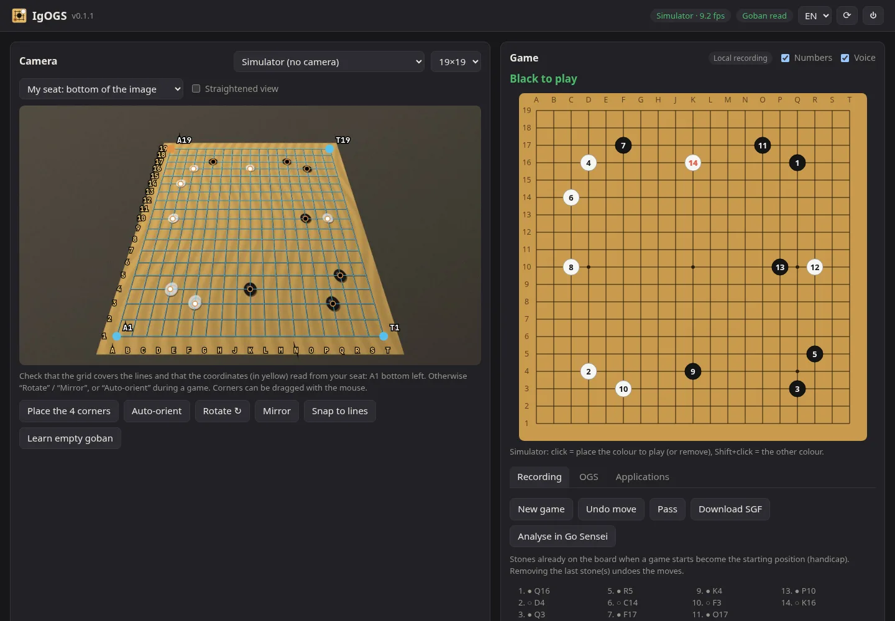
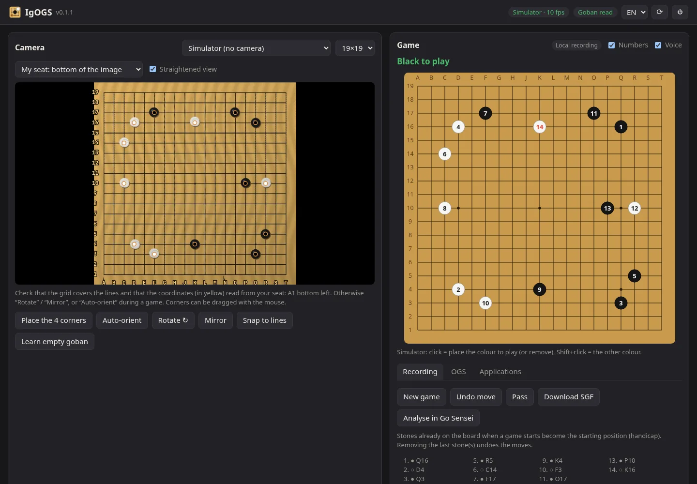

# IgOGS

*[English version](README.md)*

**Un driver caméra pour goban physique.** Une webcam filme ton goban ; IgOGS lit les pierres, en déduit
les coups et les transmet à qui veut les recevoir — comme une planche électronique (DGT Pegasus), mais
avec ton propre goban en bois.

- **Jouer sur OGS** (online-go.com) sur ton goban : tes coups partent tout seuls, ceux de l'adversaire
  s'affichent (et sont annoncés à voix haute) pour que tu les poses.
- **Analyser avec [Go Sensei](https://forgejo.aaaoz.fr/Rimso/go-sensei)** : bouton « 📷 Goban », la position
  affichée et le goban restent synchronisés dans les deux sens.
- **Enregistrer** une partie jouée à deux et la télécharger en SGF (ou l'envoyer à Go Sensei).
- **Toute autre appli** peut se brancher via un petit protocole HTTP local : voir [PROTOCOL.md](PROTOCOL.md).

Interface en français et en anglais (FR / EN en haut à droite).

Recréation en Python d'[igoki](https://github.com/CmdrDats/igoki) (Clojure), sans réseau de neurones ni Java.



## Installation (Linux)

**AppImage (le plus simple)** : télécharge `IgOGS-x86_64.AppImage` depuis les
[releases](https://forgejo.aaaoz.fr/Rimso/IgOGS/releases). Un seul fichier d'environ 21 Mo, avec Python, un
OpenCV allégé et tout le reste dedans.

```sh
chmod +x IgOGS-x86_64.AppImage
./IgOGS-x86_64.AppImage                     # ou, pour l'avoir dans le menu :
./install.sh IgOGS-x86_64.AppImage          # (install.sh est dans le dépôt)
```

S'il répond « dlopen(): error loading libfuse.so.2 » : installer `fuse2`, ou lancer avec
`--appimage-extract-and-run`.

**Depuis les sources** :

```sh
git clone https://forgejo.aaaoz.fr/Rimso/IgOGS.git && cd IgOGS
./install.sh          # environnement Python, commande « igogs », entrée « IgOGS » dans le menu
./build-appimage.sh   # construit l'AppImage (il faut cmake et un compilateur C++)
```

- **Lancer** : menu des applications → IgOGS, ou `igogs`. S'il tourne déjà, ça rouvre simplement la page.
- **Arrêter** : bouton ⏻ en haut à droite de l'interface, menu de l'icône dans la zone de notification
  (Waybar, KDE…), ou `igogs --stop`. La caméra est libérée.
- **Redémarrer** (après une mise à jour) : bouton ⟳ ; la page se recharge toute seule.
- Options : `--port N`, `--no-browser`, `--no-tray`. Désinstaller : `./install.sh -u`.

Dépendances (sources) : Python ≥ 3.10, `numpy`, `opencv-python-headless`, `websocket-client`,
`dbus-fast` (icône).

## Mise en route

1. **Caméra** : choisis-la dans la liste (ou « Simulateur » pour essayer sans goban). Place la caméra au-dessus
   du goban, le plus à la verticale possible, tout le plateau visible.
2. **Ma place** : indique où tu es assis sur l'image de la caméra (en bas, en haut — face à la caméra —, à
   gauche, à droite). L'aperçu est tourné pour montrer le goban depuis ta place, et les coordonnées suivent :
   A1 est en bas à gauche pour toi.
3. **Coins** : « Placer les 4 coins », puis clique les 4 coins de la grille (lignes extérieures) dans
   n'importe quel ordre. La grille est ensuite **calée automatiquement sur les lignes** ; les coins restent
   déplaçables à la souris. Les coordonnées jaunes autour de la grille permettent de vérifier l'orientation
   d'un coup d'œil (sinon « Tourner » / « Miroir »).
4. **Goban vide** (recommandé) : sur un goban vide, « Mémoriser goban vide » enregistre la couleur du bois à
   chaque intersection — la lecture est alors insensible aux ombres et reflets. Sans cette étape, IgOGS
   apprend le bois tout seul au fil de la partie.

Les pastilles sur l'image montrent la lecture en direct (noir, blanc, rouge = incertain). « Vue redressée »
montre le goban tel qu'IgOGS le voit après correction de la perspective :



## Jouer sur OGS

Onglet **OGS** → pseudo + mot de passe. Le mot de passe n'est utilisé qu'une fois pour obtenir un jeton
OAuth (application publique, comme NXGo) ; seuls les jetons sont gardés, dans `~/.config/igogs/config.json`
(mode 600). Ensuite « Jouer sur le goban » sur une partie en cours.

- Pose ta pierre : dès que ta main est partie et l'image stable (~1 s), le coup est envoyé.
- Le coup de l'adversaire apparaît en **cercle pointillé** : pose-le. Les pierres à retirer (prises) sont
  **barrées en rouge**.
- Rien n'est jamais envoyé tant que le goban ne correspond pas exactement à la partie + un coup légal de ta
  couleur. Pendules, « Passer », « Abandonner » (avec confirmation) et acceptation d'annulation sont dans
  l'onglet.
- Si le goban semble tourné ou en miroir par rapport à la partie, IgOGS le signale ; « Orienter
  automatiquement » essaie les 8 orientations possibles et garde celle qui correspond.

## Jouer contre un logiciel à l'écran (Hyprland)

Onglet **Jeu à l'écran** : pour jouer sur le goban physique contre un logiciel sans API, par exemple
The Conquest of Go contre son IA. Choisissez votre couleur, puis « Suivre le jeu ».

- IgOGS trouve la fenêtre du jeu (titre contenant `conquest of go`, réglable par `screen.window` dans la
  config), la capture avec `grim` et repère seul la grille du goban (9, 13 ou 19).
- Les coups posés sur le goban sont cliqués dans le jeu : le curseur est placé par
  `hyprctl dispatch movecursor`, le clic vient d'une souris virtuelle (`/dev/uinput` accessible en écriture,
  par exemple via le groupe `input`), puis le curseur revient où il était.
- Les coups de l'adversaire sont lus à l'écran, annoncés (voix) et affichés à poser, comme sur OGS. Les
  prises et les passes du jeu sont suivies. « L'adversaire a passé » si l'IA passe (invisible sur le plateau).
- Une annulation ou une nouvelle partie dans le logiciel : IgOGS repart de la position affichée (ou
  « Resynchroniser »).
- Le jeu doit rester visible (pas sur un autre bureau), avec un thème de goban classique (lignes et pierres nettes).

## Analyser avec Go Sensei

Dans Go Sensei, bouton **📷 Goban** : Go Sensei prend la main sur le goban. IgOGS indique quoi poser ou
retirer pour reproduire la position affichée, et les coups joués sur le goban sont joués dans Go Sensei
(en variantes, analysées en direct). Retirer les dernières pierres revient en arrière.


## Enregistrer une partie

Onglet **Enregistrement** : « Nouvelle partie » (les pierres déjà posées deviennent la position de départ,
pratique pour le handicap), puis jouez. Retirer la ou les dernières pierres annule les coups. Plusieurs coups
joués vite (jusqu'à 4) sont reconnus dans le bon ordre. « Télécharger le SGF » ou « Analyser dans Go Sensei ».

## Comment ça marche

| Étape | Module | Principe |
|---|---|---|
| Image | `vision.Camera` | lecture continue (V4L2, MJPEG 1280×720) |
| Redressement | `vision.Calibration` | homographie 4 coins → plan du goban ; `refine()` maximise la réponse « ligne sombre fine » (black-hat) le long de la grille, du flou au net, en n'utilisant que les segments entre intersections vides |
| Lecture | `vision.Detector` | Lab médian sur un disque autour de chaque intersection, comparé à 3 modèles : bois *propre à chaque intersection*, noir, blanc ; démarrage à froid par itérations modèle ↔ étiquettes ; modèles affinés à chaque position stable ; gain global pour les variations de lumière |
| Stabilité | `tracker.Stabilizer` | une position n'est lue qu'après ~0,8 s sans mouvement ni intersection douteuse (main au-dessus du goban) |
| Coups | `tracker.Tracker` | diff avec la position attendue → séquence de coups légaux (prises, ko), pierres prises tolérées tant qu'elles ne sont pas retirées, annulation seulement si des pierres ont été *retirées* |
| OGS | `ogs.py` | OAuth2 (grant password, client public) + websocket temps réel du protocole officiel `online-go/goban` |

## Développement

```sh
uv pip install -e '.[dev]' && .venv/bin/pytest
```

Les tests utilisent un **goban simulé** rendu en perspective (bois, éclairage inégal, bruit, pierres
décalées) : lecture sur 9/13/19, ajustement de la grille, changements de lumière, inférence des coups,
orientation et place du joueur, flux OGS complet, et un bout-en-bout caméra simulée → SGF.

L'AppImage embarque un OpenCV compilé avec seulement ce qu'utilise IgOGS (core, imgproc, JPEG, V4L2) et un
numpy sans BLAS : 21 Mo au lieu de 88, et un peu plus rapide que les paquets complets.

Fichiers : config `~/.config/igogs/config.json`, modèle de couleurs appris `~/.local/share/igogs/model.npz`.

## Limites connues

- Une caméra déjà ouverte par une autre application (Discord, caméra virtuelle…) n'est pas lisible :
  IgOGS l'indique en nommant l'application.
- Gobans carrés 9×9, 13×13, 19×19.
- L'ajustement automatique de la grille s'abstient sur un plateau très rempli (trop peu de lignes visibles) :
  calibrer de préférence goban vide ou peu rempli.
- Pas encore de projecteur ; les pierres mortes se marquent sur OGS, pas sur le goban.

## Licence

MIT. OpenCV (embarqué dans l'AppImage) est sous licence Apache 2.0.
