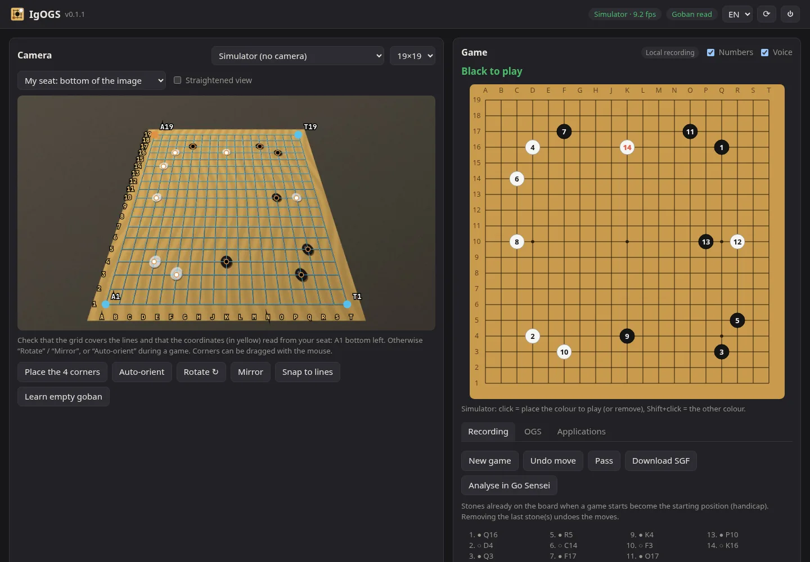
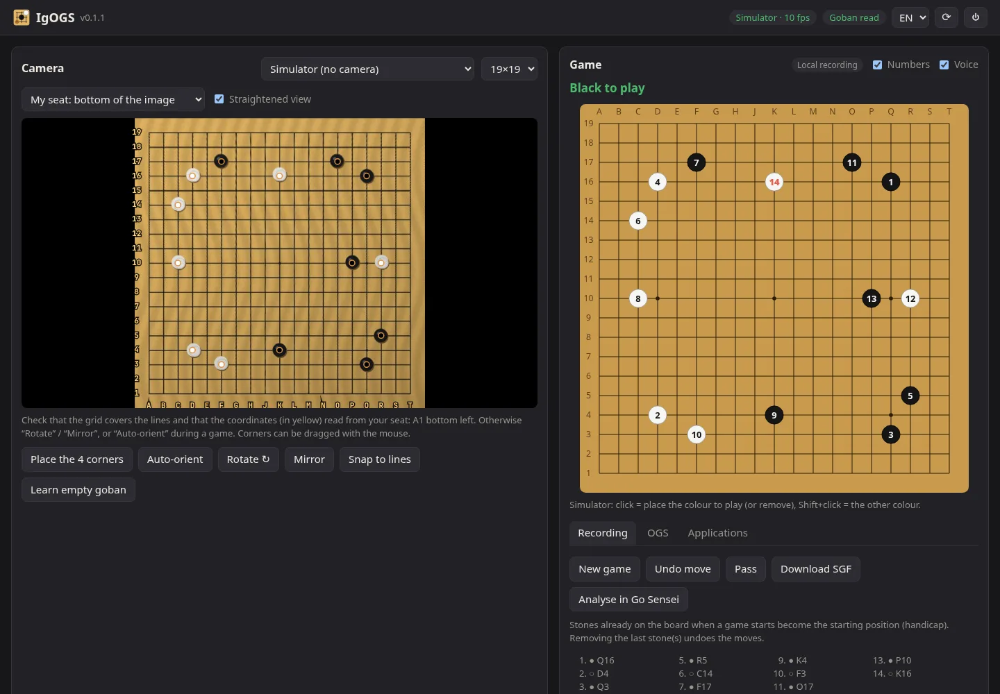

# IgOGS

*[Version française](README.fr.md)*

**A camera driver for a physical goban.** A webcam films your board; IgOGS reads the stones, works out
the moves and sends them to whoever wants them — like an electronic board (DGT Pegasus style), but with
your own wooden goban.

- **Play on OGS** (online-go.com) on your board: your moves are sent on their own, your opponent's moves
  are shown (and read out loud) so you can place them.
- **Analyse with [Go Sensei](https://forgejo.aaaoz.fr/Rimso/go-sensei)**: click “📷 Goban” and the displayed
  position and your board stay in sync both ways.
- **Record** a game played face to face and download it as SGF (or send it to Go Sensei).
- **Any other app** can plug in through a small local HTTP protocol: see [PROTOCOL.md](PROTOCOL.md).

The interface is available in English and French (EN / FR, top right).

A Python rewrite of [igoki](https://github.com/CmdrDats/igoki) (Clojure) — no neural network, no Java.



## Installation (Linux)

**AppImage (easiest)**: download `IgOGS-x86_64.AppImage` from the
[releases](https://forgejo.aaaoz.fr/Rimso/IgOGS/releases). It is a single ~21 MB file with Python, a trimmed
OpenCV and everything else inside.

```sh
chmod +x IgOGS-x86_64.AppImage
./IgOGS-x86_64.AppImage                     # or, to get it in the applications menu:
./install.sh IgOGS-x86_64.AppImage          # (install.sh is in this repository)
```

If it answers “dlopen(): error loading libfuse.so.2”, install `fuse2` or run it with
`--appimage-extract-and-run`.

**From source**:

```sh
git clone https://forgejo.aaaoz.fr/Rimso/IgOGS.git && cd IgOGS
./install.sh          # Python environment, “igogs” command, “IgOGS” menu entry
./build-appimage.sh   # builds the AppImage (needs cmake and a C++ compiler)
```

- **Start**: applications menu → IgOGS, or `igogs`. If it is already running, this just reopens the page.
- **Quit**: ⏻ button (top right of the interface), the tray icon menu (Waybar, KDE…), or `igogs --stop`.
  The camera is released.
- **Restart** (after an update): ⟳ button; the page reloads by itself.
- Options: `--port N`, `--no-browser`, `--no-tray`. Uninstall: `./install.sh -u`.

Dependencies (from source): Python ≥ 3.10, `numpy`, `opencv-python-headless`, `websocket-client`,
`dbus-fast` (tray icon).

## Getting started

1. **Camera**: pick it in the list (or “Simulator” to try without a board). Put the camera above the board,
   as straight down as you can, with the whole board in view.
2. **My seat**: tell IgOGS where you sit in the camera image (bottom, top — facing the camera —, left,
   right). The preview is rotated to show the board from your seat, and the coordinates follow: A1 is at
   your bottom left.
3. **Corners**: “Place the 4 corners”, then click the 4 corners of the grid (outer lines) in any order. The
   grid then **snaps onto the lines automatically**; corners can still be dragged with the mouse. The yellow
   coordinates around the grid let you check the orientation at a glance (“Rotate” / “Mirror” otherwise).
4. **Empty goban** (recommended): with an empty board, “Learn empty goban” records the colour of the wood at
   every point — reading then ignores shadows and reflections. Without it, IgOGS learns the wood by itself
   as the game goes.

The dots on the camera image show the live reading (black, white; red = unsure). “Straightened view” shows
the board as IgOGS sees it after the perspective correction:



## Playing on OGS

**OGS** tab → username + password. The password is only used once to get an OAuth token (public client, as
in NXGo); only the tokens are kept, in `~/.config/igogs/config.json` (mode 600). Then “Play on the goban” on a
game in progress.

- Place your stone: as soon as your hand is gone and the image is steady (~1 s), the move is sent.
- Your opponent's move shows up as a **dashed circle**: place it. Stones to remove (captures) are
  **crossed out in red**.
- Nothing is ever sent unless the board matches the game exactly plus one legal move of your colour. Clocks,
  “Pass”, “Resign” (with confirmation) and accepting an undo are in the tab.
- If the board looks rotated or mirrored compared to the game, IgOGS tells you; “Auto-orient” tries the 8
  possible orientations and keeps the one that matches.

## Playing against Go software on screen (Hyprland)

**On-screen game** tab: to play on the physical board against software that has no API, such as
The Conquest of Go against its AI. Choose your colour, then “Follow the game”.

- IgOGS finds the game window (title containing `conquest of go`, configurable as `screen.window` in the config),
  captures it with `grim` and locates the goban grid by itself (9, 13 or 19).
- The moves you place on the board are clicked into the game: the cursor is moved with
  `hyprctl dispatch movecursor`, the click comes from a virtual mouse (`/dev/uinput` must be writable, e.g. by
  being in the `input` group), then the cursor goes back where it was.
- The opponent's moves are read on screen, announced (voice) and shown to be placed, like on OGS. Captures
  and passes in the game are followed. Use “Opponent passed” if the AI passes (a pass is invisible on the board).
- An undo or a new game in the software: IgOGS starts again from the displayed position (or “Resync”).
- The game must stay visible (not on another workspace), with a classic board theme (crisp lines and stones).

## Analysing with Go Sensei

In Go Sensei, click **📷 Goban**: Go Sensei takes control of the board. IgOGS shows what to place or remove
to reproduce the displayed position, and the moves you play on the board are played in Go Sensei (as
variations, analysed live). Removing the last stones goes back.


## Recording a game

**Recording** tab: “New game” (stones already on the board become the starting position — handy for
handicap), then play. Removing the last stone(s) undoes the moves. Several moves played quickly (up to 4) are
recognised in the right order. “Download SGF” or “Analyse in Go Sensei”.

## How it works

| Step | Module | Approach |
|---|---|---|
| Image | `vision.Camera` | continuous capture (V4L2, MJPEG 1280×720) |
| Straightening | `vision.Calibration` | 4-corner homography → board plane; `refine()` maximises a “thin dark line” (black-hat) response along the grid, coarse to fine, using only segments between empty points |
| Reading | `vision.Detector` | median Lab colour over a disc at each point, compared with 3 models: wood *specific to each point*, black, white; cold start by model ↔ label iterations; models refined on every stable position; global gain for lighting changes |
| Stability | `tracker.Stabilizer` | a position is only read after ~0.8 s with no motion and no unsure point (hand over the board) |
| Moves | `tracker.Tracker` | diff with the expected position → sequence of legal moves (captures, ko); captured stones are tolerated until removed; undo only when stones were *removed* |
| OGS | `ogs.py` | OAuth2 (password grant, public client) + the real-time websocket of the official `online-go/goban` protocol |

## Development

```sh
uv pip install -e '.[dev]' && .venv/bin/pytest
```

The tests use a **simulated goban** rendered in perspective (wood, uneven lighting, noise, off-centre
stones): reading on 9/13/19, grid snapping, lighting changes, move inference, orientation and seat changes,
the full OGS flow, and an end-to-end simulated camera → SGF run.

The AppImage embeds an OpenCV built with only what IgOGS uses (core, imgproc, JPEG, V4L2) and numpy built
without BLAS: 21 MB instead of 88 MB, and slightly faster than the full packages.

Files: config `~/.config/igogs/config.json`, learnt colour model `~/.local/share/igogs/model.npz`.

## Known limitations

- A camera already opened by another application (Discord, a virtual camera…) cannot be read: IgOGS says so
  and names the application.
- Square boards only: 9×9, 13×13, 19×19.
- Automatic grid snapping holds back on a very crowded board (too few visible lines): calibrate with an empty
  or sparse board.
- No projector support yet, and dead stones are marked on OGS, not on the board.

## License

MIT. OpenCV (embedded in the AppImage) is under the Apache 2.0 license.
